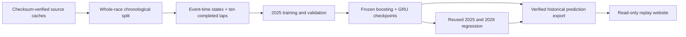

# Vroom ML/DL historical replay release

## What this release is

A CPU-trained next-lap regression research project, with gradient boosting and a
three-seed PyTorch GRU ensemble. The published public demo is a read-only replay
of precomputed predictions, NOT live inference. No subscription or GPU is needed.
The existing website inference remains available separately for comparison.

### Architecture



## Correctness changes

Parser v2 separates local yellow sectors from global RED/SC/VSC state. Text-only
race suspensions count; infringement mentions do not. Future events are excluded.
Pit-exit green lights and scheduled restart announcements do not imply resumed
racing. Actual session resumption after RED enters RESTART until explicit green.
SC/VSC ending announcements retain neutralisation until an explicit end/green.
This is deliberately conservative: missing messages can leave a stale state.

Feature reconstruction is opt-in (`control_version=2`); legacy reconstruction and
frozen artifacts remain available. Context and history use the same parser.
Restart counts, elapsed time since restart, and local sector counts are available
to the sequence models. Original labels, race partitions and eligibility rules
are unchanged. This is historical event-time reconstruction, not proof that
every source field would have been available with zero live publication latency.

## Measured results

Training: 6,083 histories / 13 races in 2025. Validation: 2,285 / five races.
Reused 2025 benchmark: 1,452 / three races. Frozen 2026 regression: 7,195 / 15 races.
Six tree configurations and GRU seeds 11/29/47. No 2026 training or tuning.
2025 validation selected restart boosting with ratio 1.5 and 15 leaves:
equal-race validation MAE **0.8423 seconds**. All targets, including interruptions,
remain in scoring.

| Model | 2026 equal-race MAE | Pooled RMSE | Pooled R² |
|---|---:|---:|---:|
| Rolling median | 6.0457 | 74.3542 | 0.0359 |
| Unmodified boosting, corrected states | 7.7952 | 110.0542 | -1.1121 |
| Restart boosting, corrected states | 5.1714 | 74.4971 | 0.0322 |
| Restart GRU, corrected states | 5.1872 | 74.6846 | 0.0273 |

Important trade-off: the previous restart models achieved 5.0590 / 5.0688 seconds
on the same 2026 cohort. Corrected states are NOT an across-the-board accuracy win.
However, on the same 16 source-annotated Monaco resumption targets, GRU error
improves from 27.9364 to **18.4600 seconds** (boosting 27.6403 → 27.0881).
The corrected-feature immediate restart slice has 13 examples / one race, with
GRU MAE 5.6156 seconds. Do not generalize this sparse slice to every restart.
Long target laps themselves still have large errors. Median remains slightly
better on pooled RMSE and R². No causal strategy or live performance claims.

## Reproduce

Use Python with project `[dl,audit,dev]` dependencies. Local measured runtime:
Python 3.9.6, PyTorch 2.8.0, scikit-learn 1.6.1, NumPy 2.0.2.
Use fresh output directories; existing experiment artifacts must never be replaced.
From `F1-Intelligence-Lab`, substitute absolute source/run paths:

```bash
PYTHONPATH=src python -m f1_intelligence_lab.robust_train \
  --dataset "$DATASET" --source-root "$SOURCE_DATA" --frozen-run "$ORIGINAL_RUN" \
  --output "$TRAIN_RUN" --control-version 2

PYTHONPATH=src python -m f1_intelligence_lab.restart_evaluate \
  --dataset "$DATASET" --source-root "$SOURCE_DATA" --robust-run "$TRAIN_RUN" \
  --original-evaluation "$ORIGINAL_2026_EVAL" --output "$EVAL_RUN" --evaluate-2026

PYTHONPATH=src python -m f1_intelligence_lab.export_demo \
  --dataset "$DATASET" --source "$SOURCE_DATA" --training "$TRAIN_RUN" \
  --evaluation "$EVAL_RUN" --output demo-export

F1_DEMO_EXPORT="$PWD/demo-export" PYTHONPATH=src \
  python -m uvicorn f1_intelligence_lab.demo_app:app --host 127.0.0.1 --port 8766
```

Training run: `.local-data/ml-runs/state-v2-2025-2026-10-28`.
Evaluation: `.local-data/ml-runs/state-v2-2026-evaluation`.
Local registry: `.local-data/ml-runs/model-registry.json` (staging, not production).
`replay-pipeline.json` documents these stages; it is a validated specification,
not an installed scheduler. Training-only feature rankings and candidate logs
are retained. Export checks matching model/evaluation artifacts, finite outputs,
and selected-model 2025 validation MAE no worse than median.

## Demo deployment and rollback

Verification for this release: **164 automated tests pass**. The complete
training replay matches scores, seed metrics, CV/stress results and predictions
exactly. A second export matches all four package files byte-for-byte. Pipeline
specification validation reports zero errors/warnings. Browser checks covered
race/model/driver selection and the expanded evidence table. Rollback and corrupt
package rejection are tested. Thirty loopback full-data requests had median
7.22 ms / maximum 12.16 ms on this machine; this is not a public-network SLA.

The export contains 36 races and five model/baseline choices; no model pickle,
API keys, raw caches or user files. It is about 7.2 MB. For static hosting, publish
only `demo-export/index.html`, `demo.js`, `data.json` and `manifest.json` together.
For a small ASGI container, from this directory:

```bash
docker build -f Dockerfile.demo -t vroom-replay .
docker run --rm -p 8000:8000 --read-only --tmpfs /tmp vroom-replay
```

Dockerfile uses a non-root user. The standalone app exposes only allowlisted
assets, a redirect and a checksum-backed health endpoint—no import jobs/uploads.
The browser only reads the export; model changes require a new export. The
full development portal is NOT the intended public deployment entry point.
The local Docker daemon was unavailable, so this container build is unverified.
Public historical replay: https://vroom-race-replay-jeyanth.quantum-banana.chatgpt.site
Published through Sites on 28 October 2026; no paid infrastructure was provisioned.
Only HTML, JavaScript and precomputed prediction JSON were published. The main
GitHub repository remains private; checkpoints and raw caches were not uploaded.
See [deployment record](PUBLIC-DEMO.md) for verification and rollback details.
Provider data redistribution terms still need a documented review; hosting
success is not a licensing approval.

For local portal integration, set `F1_DEMO_EXPORT` and open `/model-demo/`, or use
the race dossier's “11 ML / DL race replay” link. Rollback: point that variable
at a prior verified export and restart. Do not overwrite the previous directory.
Unsetting it disables replay with 503 and leaves old inference untouched.

Operational scope: manual research pipeline, historical batch serving, no live
latency SLA promised. Suggested pre-public-launch checks: healthy assets,
no 5xx in smoke tests, working driver/model selectors, no secrets in export,
and rollback smoke test. Container health is checked every 30 seconds when run.
No background monitoring service or notification subscription is installed.
Static replay has no incoming feature stream to monitor for drift; each future
data refresh needs a new coverage/error review, not automatic retraining.

## Résumé wording

**Vroom — F1 ML/DL Race Analysis** · Python, PyTorch, scikit-learn, FastAPI, JavaScript

- Built an event-time feature pipeline and trained gradient-boosting and GRU
  next-lap regressors on 2025 race data with race-separated validation.
- Evaluated frozen models on 7,195 eligible laps from 15 previously examined
  2026 races; achieved 5.17-second equal-race MAE versus a 6.05-second rolling
  median baseline, with documented interruption and restart failure analysis.
- Published a 36-race historical replay dashboard with driver/model selection,
  predicted-versus-actual charts, checksum-verified artifacts and reproducible tests.

Describe this as a public historical replay, not a production live ML service.
Do not claim live prediction, unseen-2026 accuracy, all races, or that DL beats boosting.
