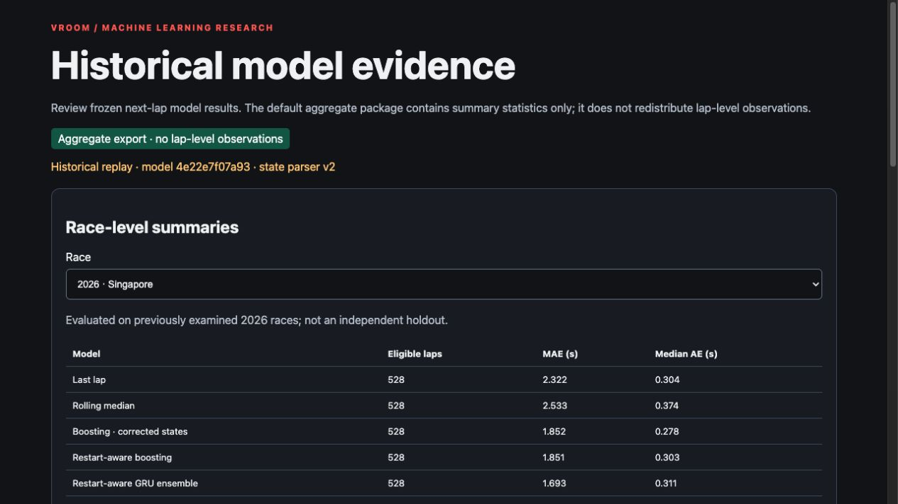
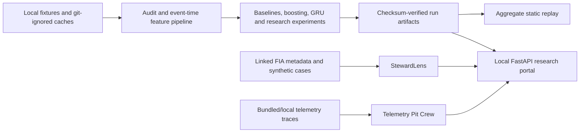

# Vroom — F1 race intelligence and honest ML evaluation

[](https://github.com/JeyanthRavi/vroom/actions/workflows/ci.yml)
[](https://jeyanthravi.github.io/vroom/)
[](pyproject.toml)

**Vroom is a FastAPI Formula 1 research platform for race analysis and
leakage-controlled next-lap prediction.** It combines race dossiers, telemetry
comparison and evidence-linked stewarding with rolling baselines, tree models
and a compact GRU. The key result is deliberately honest: learned models improve
some error slices but do not beat the rolling-median baseline on every metric.

[](https://jeyanthravi.github.io/vroom/)

**[Open the public aggregate demo](https://jeyanthravi.github.io/vroom/)** ·
[Read the model card](F1-Intelligence-Lab/MODEL-CARD.md)

| Project snapshot | Details |
| --- | --- |
| Stack | Python, FastAPI, scikit-learn, PyTorch, pytest, Ruff, mypy, Docker |
| ML question | Can sequence/tree models predict the next eligible lap better than strong rolling baselines? |
| Evaluation | Chronological whole-race splits, 2025 model selection, explicitly non-independent examined 2026 cohort |
| Product | Race analysis, telemetry, steward review and checksum-verified aggregate replay |
| Quality | 209 tests in the final Torch-enabled suite; public CI runs lint, typing, tests, demo and container builds |

> **Unofficial research project.** Vroom is not affiliated with Formula 1, the
> FIA, or any team. The public demo contains aggregate statistics only. Read
> [NOTICE.md](NOTICE.md) and the
> [data-rights review](F1-Intelligence-Lab/DATA-RIGHTS-REVIEW.md).

## 60-second local quickstart

Requires Python 3.9+ and a POSIX shell.

```bash
make setup
source F1-Intelligence-Lab/.venv/bin/activate
uvicorn f1_intelligence_lab.app:app --host 127.0.0.1 --port 8765
```

Open <http://127.0.0.1:8765/>. Provider import/write endpoints are disabled unless you configure the controls in [CONFIGURATION.md](CONFIGURATION.md). To run the offline aggregate replay instead:

```bash
make public-demo
F1_DEMO_EXPORT="$PWD/.build/public-demo" \
  uvicorn f1_intelligence_lab.demo_app:app --host 127.0.0.1 --port 8765
```

## Architecture



## Project map

| Path | Purpose | Default data posture |
|---|---|---|
| [`F1-Intelligence-Lab/`](F1-Intelligence-Lab/README.md) | Portal, historical library, race dossiers, ML/DL and static replay | Local caches ignored; aggregate export is public-safe default |
| [`F1-StewardLens/`](F1-StewardLens/README.md) | Evidence-linked simulated steward analysis and measured NLP feasibility work | Bundled synthetic/metadata fixtures; no PDF scraping |
| [`F1-Telemetry-Pit-Crew/`](F1-Telemetry-Pit-Crew/README.md) | Deterministic lap-trace comparison and rule-based specialist agents | Bundled compact fixture; optional local FastF1 adapter |
| `research/` | Pre-registered questions, experiment outputs and reports | Protocol is committed before experiment code |
| [`F1-Intelligence-Lab/public-results/`](F1-Intelligence-Lab/public-results/) | Versioned aggregate result inputs for the Pages build | No driver-lap tables or observed lap durations |

## Results summary

<!-- BEGIN GENERATED: core-results -->
Evaluated on previously examined 2026 races; not an independent holdout.
The default was selected using 2025 validation only.

| Model | Equal-race MAE (s) | Pooled RMSE (s) | R² | Rows |
|---|---:|---:|---:|---:|
| Rolling median | 6.046 | 74.354 | 0.036 | 7195 |
| Restart-aware boosting | 5.171 | 74.497 | 0.032 | 7195 |
| Restart-aware GRU | 5.187 | 74.685 | 0.027 | 7195 |

The rolling median remains the pooled-RMSE/R² reference; learned models do not improve every metric. Source: `F1-Intelligence-Lab/public-results/aggregate-results.json`.
<!-- END GENERATED: core-results -->

New RQ1–RQ4 outputs will be reported in `research/RESULTS.md`. Fixture-only runs are explicitly labelled **not evidence**.

## Development commands

```bash
make lint       # Ruff E/F/I/B/C4/SIM checks
make type       # mypy across all source trees; no global bypass, named legacy boundary
make test       # full suite; PyTorch tests skip when torch is absent
make test-torch # assert torch exists, then run the full suite
make demo       # validate aggregate replay and checksum-serving path
make public-demo # build the ignored static Pages artifact in .build/
make docs       # check internal Markdown file links
```

CI repeats tests on Python 3.9 and 3.12, includes a CPU-PyTorch job, enforces
Ruff and mypy, validates the aggregate demo, and builds both Docker images.
GitHub Pages builds from the versioned aggregate result inputs; generated site
files are not committed to the repository.

## Honest limitations

- Historical provider timestamps are not captured feed-arrival timestamps; this is not a certified live replay.
- The 2026 cohort has already been examined and cannot support an “unseen holdout” claim.
- Race-level samples are few, long interruption laps dominate some errors, and exchangeability assumptions behind bootstrap intervals are imperfect.
- Linked FIA documents and provider access do not establish redistribution permission. The hosted full replay should remain private pending clarification; the checked-in deployment default is aggregate-only.
- StewardLens outputs are simulated educational review, and Telemetry Pit Crew has limited bundled trace coverage.
- No source-code licence has been selected yet; see [OPEN-QUESTIONS.md](OPEN-QUESTIONS.md).

See [CONTRIBUTING.md](CONTRIBUTING.md), [CONFIGURATION.md](CONFIGURATION.md), and the final [progress log](PROGRESS-LOG.md) for reproducibility and release evidence.
