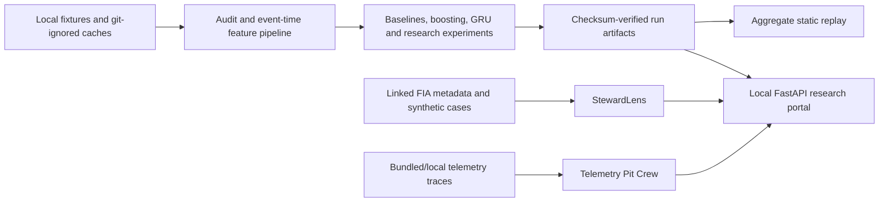

# Vroom — F1 race intelligence research

> **Unofficial research project.** Vroom is not affiliated with Formula 1, the FIA, or any team. Third-party data and marks remain with their owners; public redistribution permission for lap-level historical data is unresolved. Read [NOTICE.md](NOTICE.md) and the [data-rights review](F1-Intelligence-Lab/DATA-RIGHTS-REVIEW.md).

Vroom is a Python/FastAPI research workspace for retrospective Formula 1 race analysis. It combines a historical race library, pace/stint/pit-stop and race-control views, leakage-controlled next-lap ML/DL experiments, evidence-linked simulated steward review, and deterministic telemetry comparisons. It is not live timing, team strategy, official stewarding, or betting advice.

## 60-second local quickstart

Requires Python 3.9+ and a POSIX shell.

```bash
make setup
source F1-Intelligence-Lab/.venv/bin/activate
uvicorn f1_intelligence_lab.app:app --host 127.0.0.1 --port 8765
```

Open <http://127.0.0.1:8765/>. Provider import/write endpoints are disabled unless you configure the controls in [CONFIGURATION.md](CONFIGURATION.md). To run the offline aggregate replay instead:

```bash
F1_DEMO_EXPORT="$PWD/F1-Intelligence-Lab/demo-export-aggregate" \
  uvicorn f1_intelligence_lab.demo_app:app --host 127.0.0.1 --port 8765
```

## Architecture



## Project map

| Path | Purpose | Default data posture |
|---|---|---|
| [`F1-Intelligence-Lab/`](F1-Intelligence-Lab/README.md) | Portal, historical library, race dossiers, ML/DL and static replay | Local caches ignored; aggregate export is public-safe default |
| [`F1-StewardLens/`](F1-StewardLens/README.md) | Evidence-linked simulated steward analysis and measured NLP feasibility work | Bundled synthetic/metadata fixtures; no PDF scraping |
| [`F1-Telemetry-Pit-Crew/`](F1-Telemetry-Pit-Crew/README.md) | Deterministic lap-trace comparison and rule-based specialist agents | Bundled compact fixture; optional local FastF1 adapter |
| `research/` | Pre-registered questions, experiment outputs and reports | Protocol is committed before experiment code |
| [`F1-Intelligence-Lab/demo-export-aggregate/`](F1-Intelligence-Lab/demo-export-aggregate/manifest.json) | Checksum-verified summary replay | No driver-lap tables or observed lap durations |

## Results summary

<!-- BEGIN GENERATED: core-results -->
The current frozen evidence shows that a simple rolling-median baseline remained stronger than the learned sequence models on the overall previously examined 2026 cohort. Restart-aware variants improved equal-race MAE in that regression check but did not improve every pooled metric, and very long interruption laps remain a severe failure slice. See the frozen [cross-season](F1-Intelligence-Lab/CROSS-SEASON-2026.md), [restart](F1-Intelligence-Lab/RESTART-2026-RESULTS.md), and [sequence](F1-Intelligence-Lab/SEQUENCE-RESULTS.md) reports for artifact-derived tables. Evaluated on previously examined 2026 races; not an independent holdout.
<!-- END GENERATED: core-results -->

New RQ1–RQ4 outputs will be reported in `research/RESULTS.md`. Fixture-only runs are explicitly labelled **not evidence**.

## Development commands

```bash
make lint       # release-scope static lint
make type       # permissive legacy type check; stricter for new research modules
make test       # full suite; PyTorch tests skip when torch is absent
make test-torch # assert torch exists, then run the full suite
make demo       # validate aggregate replay and checksum-serving path
make docs       # check internal Markdown file links
```

CI repeats tests on Python 3.9 and 3.12, includes a CPU-PyTorch job, validates the demo, and builds both Docker images.

## Honest limitations

- Historical provider timestamps are not captured feed-arrival timestamps; this is not a certified live replay.
- The 2026 cohort has already been examined and cannot support an “unseen holdout” claim.
- Race-level samples are few, long interruption laps dominate some errors, and exchangeability assumptions behind bootstrap intervals are imperfect.
- Linked FIA documents and provider access do not establish redistribution permission. The hosted full replay should remain private pending clarification; the checked-in deployment default is aggregate-only.
- StewardLens outputs are simulated educational review, and Telemetry Pit Crew has limited bundled trace coverage.
- No source-code licence has been selected yet; see [OPEN-QUESTIONS.md](OPEN-QUESTIONS.md).

See [CONTRIBUTING.md](CONTRIBUTING.md), [CONFIGURATION.md](CONFIGURATION.md), and the final [progress log](PROGRESS-LOG.md) for reproducibility and release evidence.
